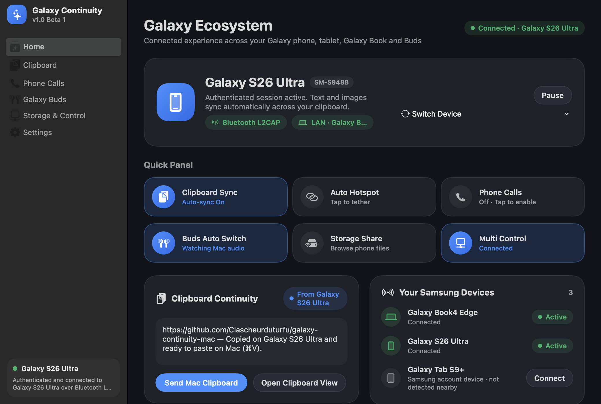
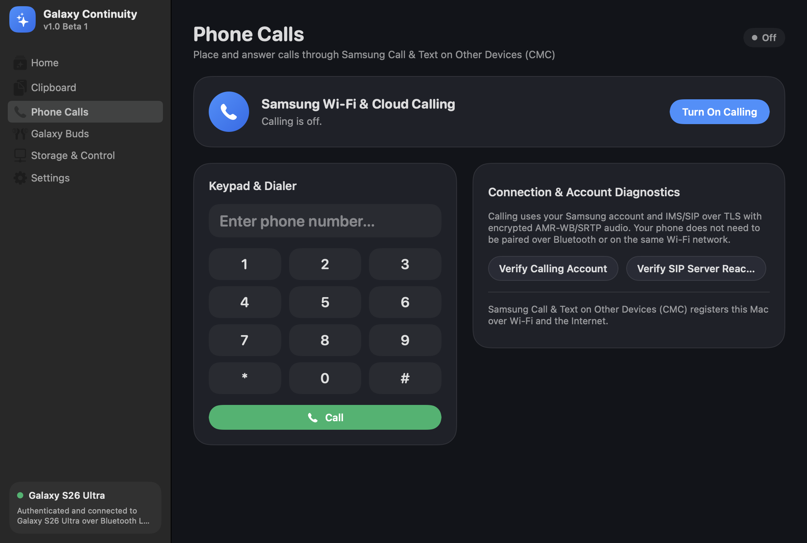
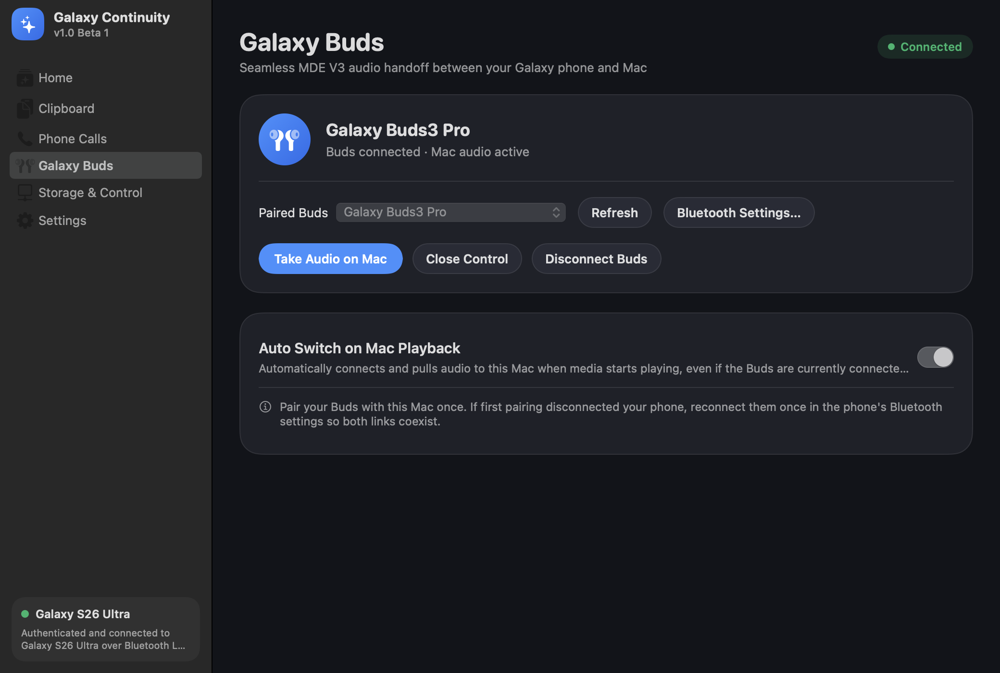
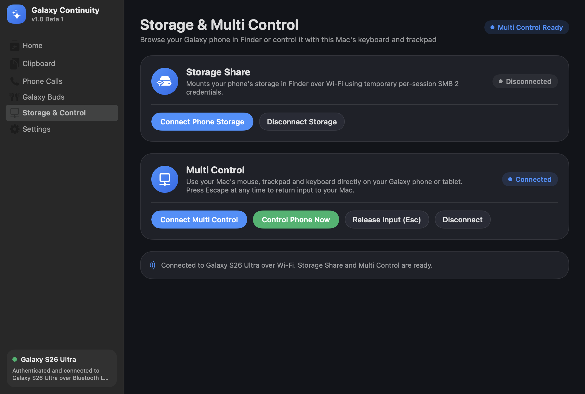

# Galaxy Continuity for macOS

[-1472FF)](ROADMAP.md)
[](Package.swift)
[](Package.swift)
[](docs/research/validation.md)
[](LICENSE)

**Galaxy Continuity** brings the Samsung Galaxy Book connected ecosystem natively to macOS—written in Swift and SwiftUI, speaking Samsung's wire protocols directly over Bluetooth Low Energy, Classic Bluetooth RFCOMM, LAN Wi-Fi, and Samsung's IMS cloud without requiring a Windows relay or an Android helper app.



---

## Highlights

- **Smart Galaxy Book–Style Auto-Connect:** Connects automatically to your preferred Galaxy phone on launch, when your phone is detected nearby via passive BLE advertisements, when your Mac wakes from sleep, and across Wi-Fi network transitions—with exponential backoff and one-click Pause/Resume.
- **Native Samsung Account Enrollment:** Sign in with your Samsung account directly on macOS (`ASWebAuthenticationSession` + PKCE) to generate an independent RSA-2048 PKCS#10 certificate (`KC01`) and fetch your account continuity keys and registered Galaxy devices.
- **Bidirectional Clipboard Sync (Text, HTML & Images):** Copy text, rich HTML, screenshots, or photos (`PNG`, `JPEG`, `HEIC` up to 32 MiB) on your Galaxy phone, tablet, Galaxy Book, or Mac and paste (`⌘V`) on the other device automatically.
- **Phone Calls via Samsung CMC:** Place and answer cellular calls from your Mac over Wi-Fi and the Internet using Samsung Call & Text on Other Devices (`SIP/TLS`, RFC 3311 early `UPDATE`, `AMR-WB 16 kHz`, and `SDES SRTP` with macOS `VoiceProcessingIO` echo cancellation).
- **Galaxy Buds Auto Switch:** Seamlessly switches paired Galaxy Buds (such as Galaxy Buds3 Pro) to your Mac when macOS audio playback begins, using Samsung's TWU (`0xFC..0xCC`) RFCOMM protocol and MDE Auto Switch V3.
- **Storage Share (Wireless Finder Mount):** Browse your Galaxy phone's internal storage directly in macOS Finder (`/Volumes/media`) over MCF SDK AppId `10` + temporary per-session SMB credentials, with a reversible host-scoped SMB 2 compatibility lease.
- **Multi Control (Shared Mouse & Keyboard):** Control your Galaxy phone or tablet with your Mac's trackpad, mouse, and keyboard over MCF SDK AppId `1` with a dedicated `.userInteractive` worker-thread 6 ms UDP pointer pipeline.
- **Auto Hotspot:** Remotely activate your Galaxy phone's Personal Hotspot over the authenticated MCF channel (`AutoHotspotMDE`) and join its Wi-Fi network automatically via CoreWLAN.
- **One UI Design & Menu Bar Extra:** Designed after Samsung One UI / Galaxy Book Experience with quick-toggle tiles, device status pills, dark/light adaptive cards, and a persistent macOS menu bar extra.

---

## Interface Preview

| Phone Calls (Samsung CMC) | Galaxy Buds Auto Switch | Storage Share & Multi Control |
|---|---|---|
|  |  |  |

---

## Feature & Protocol Overview

| Capability | Protocol / Transport | Key Implementation Files |
|---|---|---|
| **Samsung Account & CSR Enrollment** | OAuth PKCE (`boz0m1awhe`) + RSA-2048 PKCS#10 CSR (`KC01`) | `NativeSignIn.swift`, `Enrollment.swift`, `ProfileStore.swift` |
| **BLE & Bonjour Discovery** | BLE `75 00 02 18` SHA-256 XOR table + L2CAP CoC (PSM `128`) + `_mcfds._tcp` | `BluetoothDiscovery.swift`, `BluetoothChannel.swift`, `Discovery.swift`, `NearbyPeers.swift` |
| **MCF Handshake & Framing** | 3-message AES-GCM + P-256 ECDH → AES-256-CBC `CommandPacket` | `Authentication.swift`, `AuthenticationResponder.swift`, `Transport.swift`, `Wire.swift` |
| **Clipboard Sync (Text, HTML, Images)** | Handler `2` (`Command 4` gzip JSON) + AppId `102` `ProtoData` + `SemImageClipData` | `ClipboardSession.swift`, `ClipboardTransfer.swift`, `CommandHandover.swift`, `KeyboardClipArchive.swift`, `LANPresence.swift` |
| **Auto Hotspot** | Handler `6` / AppId `4` (`AutoHotspotMDE`) + CoreWLAN | `Hotspot.swift` |
| **Phone Calls (Samsung CMC)** | ACS/Entitlement + `pc_` lease + SIP/TLS + SDP + AMR-WB/16000 + SDES SRTP | `CallingAccount.swift`, `CallingRegistration.swift`, `CallingSIPDispatcher.swift`, `CallingDialog.swift`, `CallingSDP.swift`, `CallingMediaSession.swift`, `CallingAudio.swift` |
| **Galaxy Buds Auto Switch** | IOBluetooth RFCOMM TWU (`0xFC..0xCC`, CRC-16/XMODEM) + CoreAudio | `BudsProtocol.swift`, `BudsConnection.swift`, `BudsAudio.swift`, `BudsPanel.swift` |
| **Storage Share** | MCF SDK AppId `10` (`#`-delimited messages) + `NetFS` + scoped SMB 2 lease | `FeatureSession.swift`, `StorageShare.swift`, `SMBCompatibility.swift` |
| **Multi Control** | MCF SDK AppId `1` JSON + UDP/TCP binary `M`/`W`/`C`/`K` + 6 ms worker pacer | `MultiControl.swift`, `PointerPipeline.swift`, `PointerPacer.swift`, `PointerSender.swift`, `PointerTelemetry.swift` |

---

## Building from Source

### Prerequisites
- **macOS 13.0 or later** (Apple Silicon or Intel)
- **Xcode Command Line Tools** (`xcode-select --install`)
- **Python 3** (used by `scripts/bootstrap-calling.py` to download and verify the SHA-256 hashes of `libsrtp 2.6.0`, `opencore-amr 0.1.6`, and `vo-amrwbenc 0.1.3`)

### Build & Run
```bash
# Clone the repository
git clone https://github.com/Clascheurduturfu/galaxy-continuity-mac.git
cd galaxy-continuity-mac

# Bootstrap calling C libraries, run all 100 unit tests, and build the signed release app
bash scripts/build-macos.sh

# Install to /Applications and launch
cp -R "dist/Galaxy Continuity Lab.app" /Applications/
open "/Applications/Galaxy Continuity Lab.app"
```

For completely air-gapped builds where `vendor/calling-sources/*.tar.gz` are already present:
```bash
bash scripts/build-offline-macos.sh
```

---

## Command-Line Interface (`continuity`)

Building the project also produces `dist/continuity`, a CLI tool for diagnostics and scripting:

```bash
# Show version
./dist/continuity --version

# Discover nearby Samsung MCF devices over Bonjour (_mcfds._tcp)
./dist/continuity discover 8

# Scan for Samsung BLE continuity advertisements
./dist/continuity ble-scan 8

# Authenticate with your Galaxy phone over BLE L2CAP
./dist/continuity ble-auth

# Request and print Auto Hotspot status over BLE
./dist/continuity hotspot

# List paired Galaxy Buds and test TWU multipoint takeover
./dist/continuity buds
./dist/continuity buds-connect <bt-address> --take-audio

# Verify Samsung CMC calling account & P-CSCF SIP/TLS registration
./dist/continuity cmc-check
./dist/continuity cmc-register 30
```

---

## Reverse-Engineering Documentation & Roadmap

- **[Reverse Engineering & Architecture Hub (`docs/README.md`)](docs/README.md)** — Detailed protocol specifications, cryptographic flows, packet layouts, and chronological engineering journal notes.
- **[Validation Matrix (`docs/research/validation.md`)](docs/research/validation.md)** — Breakdown of all 100 automated tests and live hardware verification results.
- **[Engineering Roadmap & Todo List (`ROADMAP.md`)](ROADMAP.md)** — All open tasks, reliability benchmarks, and planned protocol extensions.
- **[Third-Party Notices (`docs/THIRD_PARTY_NOTICES.md`)](docs/THIRD_PARTY_NOTICES.md)** — Licenses for bundled open-source components (`libsrtp`, `opencore-amr`, `vo-amrwbenc`, and `samsung-re-health` reference).

---

## License

Released under the [MIT License](LICENSE). See [docs/THIRD_PARTY_NOTICES.md](docs/THIRD_PARTY_NOTICES.md) for third-party library licenses.
