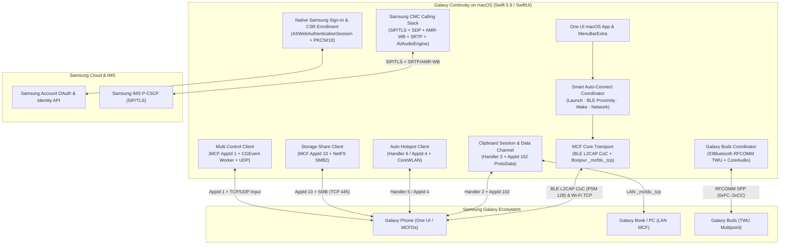

# Galaxy Continuity for macOS — Reverse Engineering & Architecture

This directory documents the reverse engineering, wire protocols, cryptographic handshakes, and native macOS implementation behind **Galaxy Continuity**.

> **Disclaimer:** These findings are independent interoperability notes observed across Samsung Galaxy Connect (`4.6.1217.0`), Android MCFDs (`4.6.12.16`), AutoHotspotMDE, Samsung Phone (`1.1.15.0`), Multi Control (`2.7.1300.0`), Storage Share (`1.3.21.0`), Nearby Devices (`3.0.22.0`), and Samsung Settings (`8.0.13.0`). No proprietary Samsung binaries, decompiled sources, or personal credentials are included in this repository.

---

## System Architecture

---

## Feature & Protocol Matrix

| Feature | Samsung Service / Handler | Transport | Encryption / Framing | Status in v1.0 Beta 1 |
|---|---|---|---|---|
| **Samsung Account & Enrollment** | `boz0m1awhe` / `KC01` | HTTPS (`play.samsungcloud.com`) | PKCE + RSA-2048 PKCS#10 CSR | Live-validated (native Mac cert + token renewal) |
| **Nearby Discovery & Smart Connect** | MCF BLE + `_mcfds._tcp` | CoreBluetooth + Bonjour | SHA-256 XOR advertisement table + AES-GCM | Live-validated (auto-connect on launch, wake & BLE proximity) |
| **Clipboard Sync (Text, HTML & Images)** | Handler 2 + AppId 102 | BLE L2CAP + Wi-Fi TCP data socket | AES-256-CBC `CommandPacket` + `ProtoData` chunks + `SemImageClipData` | Live-validated (Phone ↔ Mac & Mac ↔ Galaxy Book) |
| **Auto Hotspot** | Handler 6 / AppId 4 (`AutoHotspotMDE`) | Authenticated MCF command channel + CoreWLAN | AES-256-CBC JSON (`messagetype: 3/4`) | Live-validated |
| **Phone Calls (Samsung CMC)** | Call & Text on Other Devices | SIP/TLS to P-CSCF + UDP media | SDES SRTP (`AES_CM_128_HMAC_SHA1_80/32`) + RFC 4867 AMR-WB 16 kHz | Live-validated (incoming & outgoing two-way audio) |
| **Galaxy Buds Auto Switch** | EasyConnect / TWU MDE V3 | Classic Bluetooth RFCOMM + CoreAudio | TWU frame (`0xFC` … CRC-16/XMODEM … `0xCC`) | Live-validated (manual & automatic Mac playback takeover) |
| **Storage Share** | MCF SDK AppId 10 | Wi-Fi TCP SDK session + SMB (`ksmbd`) | SDK 3/4/5 nonce proof + AES-CBC `#`-delimited messages + NetFS SMB2 | Live-validated (Finder mount & read/write) |
| **Multi Control** | MCF SDK AppId 1 | Wi-Fi TCP control + UDP fast path | SDK AES-CBC JSON control + binary `M`/`W`/`C`/`K` input frames | Live-validated (6 ms worker-thread pacer, mouse & keyboard) |

---

## Research Reference Index

### Core Protocol & Feature Deep Dives (`docs/research/`)
1. **[MCF Protocol, BLE Discovery, Framing & Auto Hotspot](research/protocol.md)** — BLE manufacturer data (`75 00 02 18`), 12-hour rotating checksums, L2CAP CoC, protobuf `CommandPacket`, 3-message AES-GCM + P-256 ECDH handshake, and AutoHotspotMDE.
2. **[Native Samsung Account Sign-In & Certificate Enrollment](research/authentication.md)** — 6-layer OAuth/PKCE flow, cloud registration, PKCS#10 CSR generation, certificate bundle validation, and token renewal.
3. **[Clipboard Continuity (Text, HTML, Images & Galaxy PC LAN)](research/clipboard.md)** — Short gzip/JSON metadata, Wi-Fi command handover (`100/1`), AppId 102 `ProtoData` image transfers, Samsung Keyboard `SemImageClipData` archives, and LAN Galaxy Book sharing.
4. **[Samsung CMC Calling (SIP/TLS, SDP, AMR-WB & SRTP)](research/calls-cmc.md)** — ACS/entitlement discovery, reversible `pc_` device enrollment, SIP registration & `reg`/`dialog` subscriptions, RFC 3311 early `UPDATE`, AMR-WB framing, and macOS `VoiceProcessingIO`.
5. **[Galaxy Buds Auto Switch & TWU RFCOMM Protocol](research/buds.md)** — `EasyConnect2` / `BudsMsgFmtDynamic` analysis, TWU framing (`0xFC..0xCC`), MDE Auto Switch V3 commands (`44`, `73`, `43`, `71`), multipoint TLV (`0x0117`, `0x0502`), and CoreAudio monitoring.
6. **[Multi Control (Shared Mouse, Keyboard & Pointer Pipeline)](research/multi-control.md)** — MCF SDK AppId 1 handshake, JSON layout/focus protocol, binary `M`/`W`/`C`/`K` packets, `(-100, -100)` focus-release sentinel, and dedicated worker-thread 6 ms pacing.
7. **[Storage Share (Wireless Finder Mount over MCF + SMB)](research/storage-share.md)** — MCF SDK AppId 10 `#`-separated messages, on-phone consent, temporary `ksmbd` credentials, macOS NetFS `/Volumes` mounting, and scoped SMB 2 compatibility lease.
8. **[Nearby Devices & Unified Presence Registry](research/nearby-devices.md)** — How Samsung Nearby Devices separates account membership from radio presence, passive multi-peer BLE scanning, and dynamic PC port updates.
9. **[Galaxy Book & Android Component Reference Map](research/galaxy-book-reference.md)** — Architectural summary of the Windows and Android services analyzed during reverse engineering.
10. **[Hardware & Synthetic Validation Matrix](research/validation.md)** — End-to-end test results and verified boundaries across macOS, Galaxy phones, tablets, Galaxy Book, and Galaxy Buds.

### Chronological Engineering Journal (`docs/journal/`)
- **[2026-10-21 — Live Evidence Capture (Calls, Storage Share & Multi Control)](journal/2026-10-21-live-capture.md)**
- **[2026-10-22 — Morning Build, SMB2 Lease & Static Analysis](journal/2026-10-22-morning-build.md)**
- **[2026-10-22 — Wi-Fi Command Handover & Image Clipboard Handoff](journal/2026-10-22-image-handoff.md)**
- **[2026-10-22 — Multi Control Pointer Stutter Research](journal/2026-10-22-mouse-research.md)**
- **[2026-10-22 — Multi Control Worker-Thread Pointer Implementation & Telemetry](journal/2026-10-22-mouse-implementation.md)**
- **[2026-10-22 — Direct Samsung CMC Calling Architecture Brief](journal/2026-10-22-calls-implementation.md)**
- **[2026-10-22 — Samsung CMC SIP/SDP/SRTP Implementation & Registration](journal/2026-10-22-calls-progress.md)**
- **[2026-10-23 — Calls Recovery, Early UPDATE SDP & Two-Way Audio Verification](journal/2026-10-23-calls-recovery.md)**
- **[2026-10-23 — Native Tablet CMC Overseas Call Verification](journal/2026-10-23-tablet-call-test.md)**
- **[2026-10-23 — Clipboard Windows Architecture & Cellular Experiment](journal/2026-10-23-clipboard-research.md)**
- **[2026-10-23 — Nearby Devices SDK Analysis & Unified Presence](journal/2026-10-23-nearby-devices.md)**
- **[2026-10-23 — Windows Hardware Gate & Diagnostic Checkpoint](journal/2026-10-23-windows-diagnostic.md)**

---

## Roadmap & Open Engineering Tasks

See **[ROADMAP.md](../ROADMAP.md)** at the repository root for the complete engineering todo list and validation checklist.
