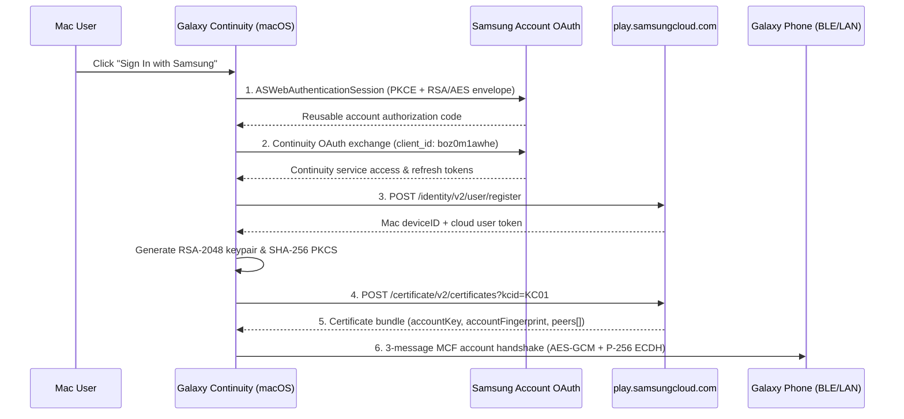

# Native Samsung Account Sign-In & Certificate Enrollment

Galaxy Continuity implements a complete, standalone Samsung account sign-in and Continuity device enrollment flow in Swift (`NativeSignIn.swift` and `Enrollment.swift`), allowing a Mac to register its own independent identity without needing a Windows PC.

---

## 1. Six-Layer Authentication & Enrollment Pipeline

1. **Samsung Account Sign-In:** An `ASWebAuthenticationSession` opens Samsung's official login page. Random `state`, PKCE (`S256`), and the SDK's RSA/AES key envelope bind the callback to the active attempt. The app validates the callback scheme, authority, timestamp age, duplicate query parameters, and account server URL before exchanging the authorization code.
2. **Continuity Service Authorization:** A second PKCE exchange authorizes Samsung's Continuity public client (`boz0m1awhe`, Galaxy Connect) with offline refresh capability.
3. **Cloud Device Registration:** `POST https://play.samsungcloud.com/identity/v2/user/register` registers the Mac installation using the service OAuth headers and deterministic installation identifiers, returning a registration device ID and cloud user token.
4. **PKCS#10 Certificate Enrollment:** The Mac generates an RSA-2048 keypair and a SHA-256 signed PKCS#10 Certificate Signing Request (CSR) in memory, using the registration ID as the Common Name (`CN`) and Samsung's expected CSR subject layout. `POST /certificate/v2/certificates?kcid=KC01` submits the CSR along with the Mac's own 6-byte Bluetooth address, explicit Mac display name/model, PC device type, and zero-IRK compatibility field.
5. **Account Keys & Peer Bundle Validation:** The returned certificate bundle includes:
   - `accountFingerprint` (used to de-obfuscate BLE advertisements)
   - Current 256-bit `accountKey` and certificate `revision`
   - `thisDevice` entry and the list of registered account `peers` (phones, tablets, Galaxy Books)
   The app verifies that `thisDevice` matches the Mac's own Bluetooth address and that the key and fingerprint are valid and non-expired before saving the profile with `borrowedIdentity = false`.
6. **Direct Peer Authentication:** The enrolled `accountKey` and Mac Bluetooth address feed directly into the BLE L2CAP and LAN TCP handshakes with the user's Galaxy devices.

---

## 2. Token Renewal, Credential Storage & Sign-Out

### Refreshing the Mac Connection
- **Refresh Mac Connection** reads the saved native authorization, refreshes the Continuity OAuth token if expired, renews the cloud user token via `/identity/v2/user/token/renew` when needed, and fetches the latest certificate/key/peer bundle.
- If an OAuth refresh token is rejected, the client automatically re-attempts service authorization using the saved account state before asking for a browser login.

### Credential Storage
- Credentials (`native-login.json`, `connection.json`, `calling-login.json`, and the calling cleanup journal) are stored with strict POSIX permissions (`0700` directory, `0600` files, rejecting symlinks and hardlinks) under `~/Library/Application Support/Galaxy Continuity Lab/Credentials`, with optional macOS Keychain storage (`CONTINUITY_USE_KEYCHAIN=1`).
- No account tokens, private keys, or user clipboard contents are written to diagnostic logs.

### Sign-Out Safety
- **Sign Out** removes only this app's local credential state. It never revokes account-wide Samsung sessions or deletes other devices' cloud registrations.
- If an enrollment refresh fails mid-flight, any previously working profile is preserved.
